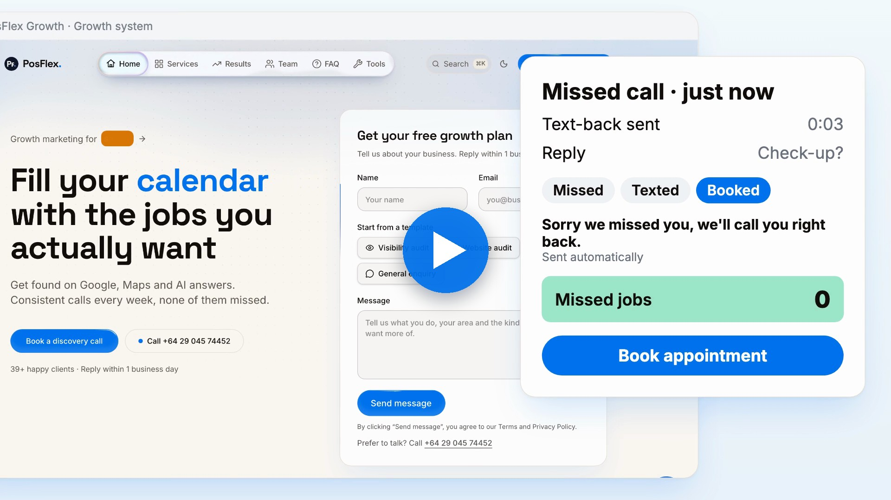
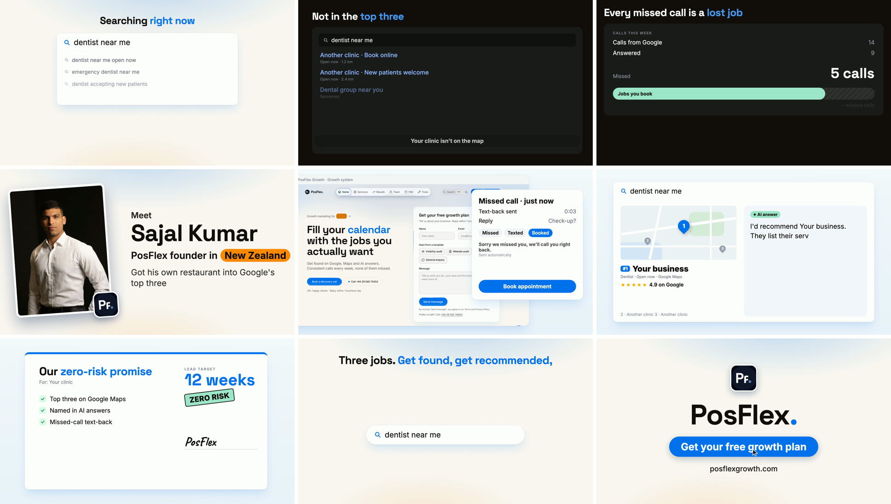

# superbrag

**Paste a website. Get a 30-second promo video in the site's own design, with a voiceover.**

[](https://aakashmehra.github.io/superbrag/)

▶️ **[Watch with sound](https://aakashmehra.github.io/superbrag/)** · [Download the MP4](media/posflexgrowth-superbrag.mp4)

`superbrag` is an AI agent skill for Claude Code and other coding agents. It turns any business website into a finished, professional promo video:
- a story written from the site's own copy
- a natural voiceover, with every animation timed to the spoken word
- music and sound effects, mixed to streaming loudness
- the site's own colours, fonts, cards and logo

The video above was made by superbrag from just one input: **`posflexgrowth.com`**.

---

## What you get

- **A 30-second 1080p MP4**, ready for LinkedIn, X, YouTube, a landing page or an ad.
- **A real story, not a slideshow.** A customer is searching right now → they can't find you → what that costs → meet the founder → the product doing its job → the proof → the offer → the payoff → the call to action.
- **The site's design language, extracted automatically:** page colour, brand colours, heading font and weight, letter-spacing, card corners and borders, shadows, button style, the colour of highlighted words, and the logo (Apple touch icon). Every video looks like the brand it's for.
- **A voiceover with word sync.** Each line is voiced, then transcribed back, so pills, stamps and highlights pop on the exact word ("*New Zealand*", "*zero-risk*", "*get booked*").
- **Only real assets.** Photos, screenshots, ratings and claims come from the website. The screens are animated UI built in code, not AI-generated pixels, so text stays sharp and correct.
- **A sound mix:** a music bed that dips under the voice, typing, clicks, stamps and chimes, at -14 LUFS.

## Storyboard

Nine beats, one concrete customer scenario. This is the PosFlex Growth video:



| # | Beat | What happens on screen |
|---|---|---|
| 1 | **Hook** | A search box types what your customer is searching for right now |
| 2 | **Problem** | Dark mode: competitors and ads rank above you |
| 3 | **Cost** | A receipt shows what that's costing you |
| 4 | **Meet** | Founder photo, logo badge, name, role, location |
| 5 | **Product** | The real website in a browser, with a panel doing the job: order, book, text back |
| 6 | **Proof** | Ranked #1, and an AI answer recommends you by name |
| 7 | **Offer** | The promise on paper: checklist, stamp, signature writing itself |
| 8 | **Payoff** | The opening search becomes the result: booked, ordered, hired |
| 9 | **CTA** | Logo, name, a button that gets clicked, URL |

## How it works

```
website URL
   │
   ├─ 1. Capture   headless browser reads copy, images, fonts, colours and the design system,
   │               and screenshots every section of the page
   ├─ 2. Story     the agent picks one customer and one scenario, then writes 9 beats from the site's own words
   ├─ 3. Voice     text-to-speech per line → word-level timestamps → scene timeline
   ├─ 4. Render    React scene library, themed with the site's design tokens, rendered frame by frame
   └─ 5. Mix       voice + ducked music + SFX → loudness-normalised MP4
```

One run takes about 3 minutes on a MacBook: capture under a minute, voice about a minute, render about 30 seconds.

## Built with

| Part | Tool |
|---|---|
| Agent | [Claude Code](https://claude.com/claude-code), or any agent that supports Agent Skills |
| Website capture | [Playwright](https://playwright.dev/) (Chromium) |
| Video engine | [Remotion](https://www.remotion.dev/) (React → MP4) |
| Voiceover | [Kokoro](https://huggingface.co/hexgrad/Kokoro-82M) (free, runs locally), or [MiniMax](https://www.minimax.io/) / [ElevenLabs](https://elevenlabs.io/) |
| Word timing | [faster-whisper](https://github.com/SYSTRAN/faster-whisper) |
| Audio and encoding | [FFmpeg](https://ffmpeg.org/) (EBU R128 loudness normalisation) |

## Initial setup

superbrag runs locally on macOS or Linux. Install these first:

```bash
# 1. Node.js 22+ and FFmpeg
brew install node ffmpeg

# 2. Headless Chromium for website capture
npm install -g playwright && npx playwright install chromium

# 3. Python 3.11 with faster-whisper (word timings)
python3.11 -m pip install faster-whisper

# 4. Kokoro: free local text-to-speech, in its own environment
brew install espeak-ng
uv venv --python 3.11 .venv && uv pip install --python .venv/bin/python kokoro soundfile pip

# 5. Remotion (video engine) + its headless browser
npm install remotion @remotion/cli react react-dom && npx remotion browser ensure
```

Optional premium voices go in a `.env` file:

```bash
MINIMAX_API_KEY=        # about 5 cents per video
ELEVENLABS_API_KEY=     # about 5 cents per video
KOKORO_PYTHON=/path/to/.venv/bin/python   # free local voice, used when no key is set
```

> Remotion is free for individuals and companies of up to 3 people. Larger teams need a [Remotion company licence](https://www.remotion.dev/license).

**The superbrag engine itself (capture, story rules, scene library, voice pipeline) is private for now.**
Want a video for your business, or early access? [Get in touch](https://www.aakashmehra.com).

## Hire me

I'm **Aakash Mehra**, a web designer and developer based in Japan, building websites for businesses worldwide. I built superbrag.

- **Websites that turn searches into customers:** restaurant sites with online ordering and bookings (no delivery-app commission), recruitment sites, and sites for trades.
- **Built for Google and AI search:** structured data, fast pages, and content that ChatGPT, Perplexity and Google's AI Overviews can quote.
- **Promo videos like the one above**, made from your website.
- **Fixed quote in writing** before anything is built.

👉 **[aakashmehra.com](https://www.aakashmehra.com)** · Start a project

Need the marketing side too (local SEO, Google Maps, AI search, ads, missed-call text-back)? That's **[PosFlex Growth](https://posflexgrowth.com)**, the team in the demo video.

## Credits

- Music in the demo: "Happy Beats / Business Moves" by Sascha Ende, [ende.app](https://ende.app/en), [CC BY 4.0](https://ende.app/en/standard-license)
- Sound effects: [Kenney](https://kenney.nl/) (CC0)

## Star history

If superbrag made you want a video like this, give it a ⭐. It helps other people find it.

<a href="https://www.star-history.com/#aakashmehra/superbrag&Date">
 <picture>
   <source media="(prefers-color-scheme: dark)" srcset="https://api.star-history.com/svg?repos=aakashmehra/superbrag&type=Date&theme=dark" />
   <source media="(prefers-color-scheme: light)" srcset="https://api.star-history.com/svg?repos=aakashmehra/superbrag&type=Date" />
   
 </picture>
</a>

---

© 2026 Aakash Mehra. All rights reserved. The demo video shows [PosFlex Growth](https://posflexgrowth.com) and is shared with permission.
